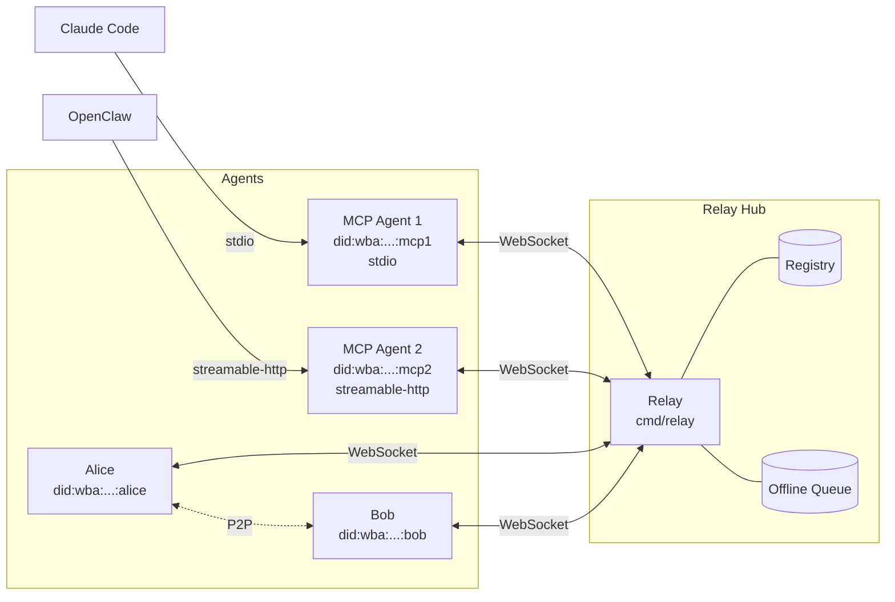

# msg2agent

[](https://github.com/gianlucamazza/msg2agent/actions/workflows/ci.yml)
[](https://goreportcard.com/report/github.com/gianlucamazza/msg2agent)
[](LICENSE)

Relay + MCP server that lets AI agents exchange signed messages using DID identities, with optional end-to-end encryption.

## Project Status

**Beta (v0.1.0), self-host first.** The only tagged release is [v0.1.0](https://github.com/gianlucamazza/msg2agent/releases/tag/v0.1.0). Breaking changes will be communicated via CHANGELOG.md.

Optional billing (`--billing-db`) implements tenants, hashed API keys, and usage quotas in-process. Stripe Checkout, Customer Portal, and webhooks are wired when `STRIPE_SECRET_KEY` is set (`sk_test_…` or `sk_live_…`); without that key, billing is local metering only.

The public hosted relay at `msg2agent.xyz` is **currently unavailable**; self-host. Instructions for the hosted path are kept below and will work again if the service returns. This repo does not claim availability, SLA, or uptime.

## Features

- **DID identity**: W3C DID documents (`did:wba:domain:agent:name`) with Ed25519 signing keys
- **Signed messaging**: outgoing messages are Ed25519-signed; bodies are encrypted with X25519 + NaCl box (XSalsa20-Poly1305) when the recipient key is known (fail-closed if `RequireEncryption` is set)
- **Relay hub**: central message routing over WebSocket
- **A2A protocol**: Google Agent-to-Agent adapter
- **MCP integration**: Model Context Protocol server (stdio and streamable-HTTP)
- **Observability**: Prometheus metrics, OpenTelemetry tracing

## Architecture



See [Architecture docs](docs/architecture.md) for details.

## Use Cases

- **Local multi-agent setups**: agents share a self-hosted relay, keep their own signing/encryption keys, and address each other by DID.
- **Local-first AI assistant extensions**: expose a local MCP server so Claude or OpenClaw can list agents, send messages, and submit A2A tasks.
- **DID-addressed routing**: the relay routes by DID rather than by a hard-coded host:port (the relay itself is still a central hop).
- **Cross-protocol interop**: DID identity plus the A2A and MCP adapters, when you run both sides yourself.

## Quick Start

Self-host first. The public relay at `msg2agent.xyz` is **currently unavailable**.

### 1. Build and run locally

```bash
go build -o relay ./cmd/relay
go build -o mcp-server ./cmd/mcp-server

# Terminal 1: Start relay
./relay -addr :8080

# Terminal 2: Start MCP server for Claude / OpenClaw
./mcp-server -name my-agent -relay ws://localhost:8080 -transport streamable-http -addr :3001
```

Relay liveness: `curl http://localhost:8080/health` → `ok`. See the [Getting Started Guide](docs/getting-started.md) for a complete walkthrough.

### 2. Use with Claude Code (local)

```bash
claude mcp add msg2agent -- ./mcp-server -name my-agent -relay ws://localhost:8080
```

Once added, Claude can call `list_agents`, `send_message`, `submit_task` and the other MCP tools.

### 3. Hosted relay (currently unavailable; self-host)

The hosted path is kept here so it can be reused if `msg2agent.xyz` comes back. Do not treat it as an availability promise.

```bash
# Currently unavailable — self-host instead (step 1).
# If the hosted relay returns: get an API key at msg2agent.xyz, then:
claude mcp add msg2agent -e MSG2AGENT_API_KEY=your_key -- \
  ./mcp-server -name my-agent -relay wss://msg2agent.xyz \
  -transport streamable-http -addr :3001
```

### 4. Use with Claude.ai (custom connector; currently unavailable)

The relay code can serve OAuth 2.1 + PKCE and a connector manifest at `/.well-known/mcp-connector.json`. That hosted URL is **currently unavailable**; point a custom connector at your own HTTPS MCP server instead.

1. Open Claude → **Settings → Connectors → Add Custom Connector**
2. When hosting your own relay, paste your connector URL (self-host). The previous hosted URL was:

   ```
   https://msg2agent.xyz/.well-known/mcp-connector.json
   ```

3. Click **Connect**. On a working host, Claude redirects to Google sign-in; after consent, the 14 MCP tools (`list_agents`, `send_message`, `submit_task`, …) appear.

Auth on a working host is per-user OAuth 2.1 with PKCE and Dynamic Client Registration. Sign-up on [msg2agent.xyz](https://msg2agent.xyz) is **currently unavailable**.

### 5. Use with OpenClaw (in-repo plugin; not published)

The OpenClaw plugin lives in [`docs/openclaw-plugin/`](docs/openclaw-plugin/README.md). It is **not published** on ClawHub or npm (`clawhub.ai/api/v1/skills/msg2agent` → 404; `npm view msg2agent` → 404). Point OpenClaw at your own MCP server:

```json
{
  "mcpUrl": "http://localhost:3001/mcp",
  "apiKey": "msg2a_your_key_here"
}
```

## Documentation

| Document                                              | Description                             |
| ----------------------------------------------------- | --------------------------------------- |
| [Getting Started](docs/getting-started.md)            | Build, run, and send your first message |
| [Architecture](docs/architecture.md)                  | System design and core concepts         |
| [Configuration](docs/operations/configuration.md)     | All configuration options               |
| [API Reference](docs/api/jsonrpc.md)                  | JSON-RPC methods and protocols          |
| [Deployment](docs/deployment/)                        | Docker, Kubernetes, TLS setup           |
| [Monitoring](docs/operations/monitoring.md)           | Prometheus, Grafana, tracing            |
| [Troubleshooting](docs/operations/troubleshooting.md) | Common issues and solutions             |
| [OpenClaw Plugin](docs/openclaw-plugin/README.md)     | OpenClaw integration via MCP            |
| [Anthropic Marketplace](docs/marketplace/anthropic.md) | Publish on Claude Marketplace          |
| [Billing Setup](docs/marketplace/billing-setup.md)    | Multi-tenant billing: tenants, API keys, usage |
| [Billing Client Guide](docs/marketplace/billing-client-guide.md) | API key usage, error codes, rate-limit back-off |
| [Glossary](docs/glossary.md)                          | Term definitions                        |

## Project Structure

```
cmd/
  relay/          # Relay hub binary
  mcp-server/     # MCP protocol adapter
pkg/
  agent/          # Agent implementation
  billing/        # Tenant management, API keys, usage metering
  config/         # Configuration helpers
  conversation/   # Threaded conversation storage
  crypto/         # Encryption and signing
  identity/       # DID management
  mcp/            # MCP server core (tools, resources, inbox)
  messaging/      # Message types and routing
  protocol/       # JSON-RPC wire protocol
  queue/          # Offline message queueing (store-and-forward)
  registry/       # Agent storage (memory, file, SQLite)
  security/       # Access control lists
  transport/      # WebSocket, stdio, SSE transports
  telemetry/      # Metrics and tracing
adapters/
  a2a/            # A2A protocol adapter
  mcp/            # MCP protocol adapter
infrastructure/   # Docker Compose + agentcard + grafana
scripts/          # Development/deployment/scenario scripts
test/             # Integration and E2E tests
docker-compose*.yml  # Docker Compose configurations
```

## Requirements

- Go 1.24+
- Docker (optional, for containerized deployment)

## Contributing

Contributions are welcome. Please read [CONTRIBUTING.md](CONTRIBUTING.md) for the development workflow, branch naming, and commit conventions. By participating you agree to the [Code of Conduct](CODE_OF_CONDUCT.md). For security issues, see [SECURITY.md](SECURITY.md).

## License

Apache 2.0 - See [LICENSE](LICENSE) for details.
